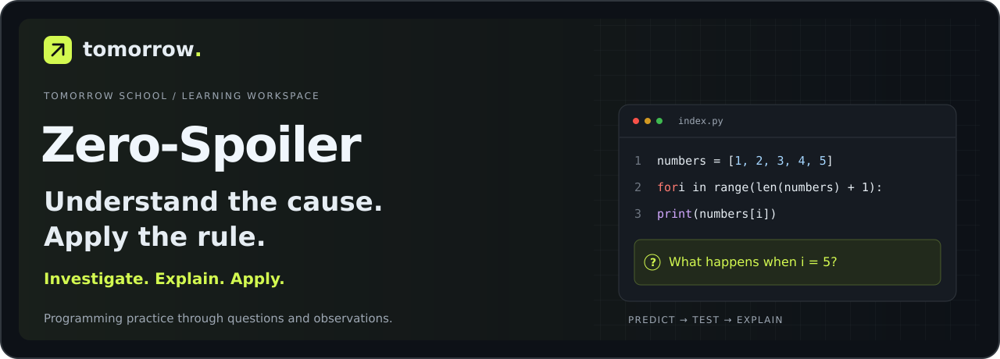
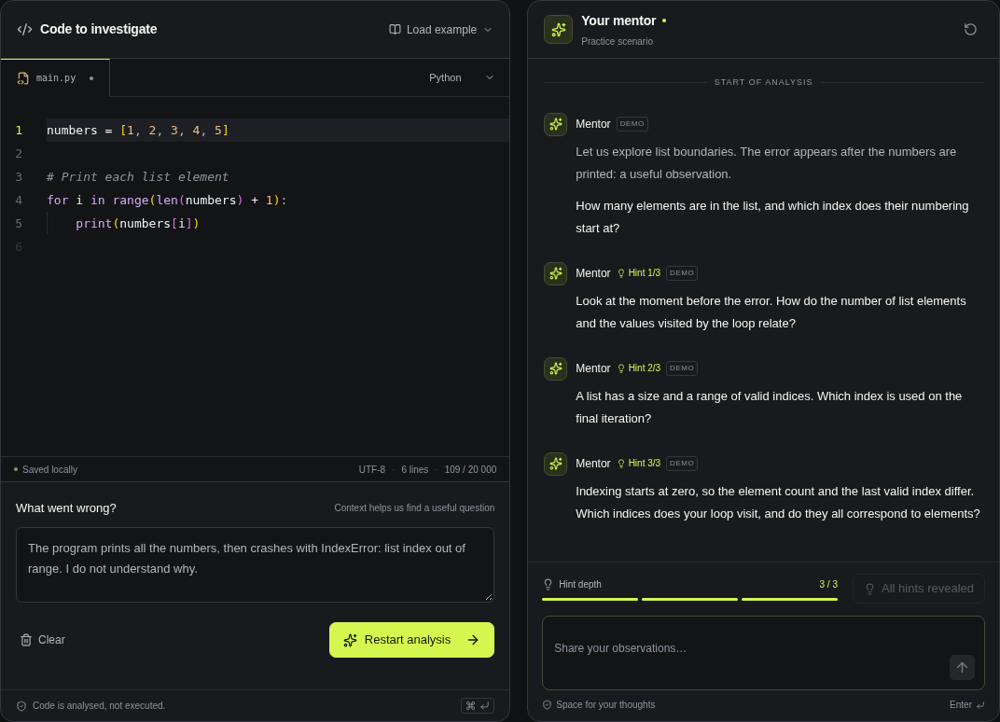

[Русский](README.md) · [Қазақша](README.kk.md) · [English](README.en.md)

<p align="center"></p>

<h1 align="center">Zero-Spoiler Debugger</h1>

<p align="center"><strong>From a first guess to a rule a student can explain and apply.</strong><br>A workspace for investigating code errors. A Tomorrow School case.</p>

<p align="center"><a href="https://2-case.vercel.app/?lang=en"><strong>Open the app</strong></a> · <a href="https://2-case.vercel.app/investigation?mode=jury&amp;lang=en"><strong>Jury demo</strong></a> · <a href="docs/presentation/README.md"><strong>Presentation materials</strong></a></p>

<p align="center"></p>

---

## The code works. Did the student understand?

After fixing an error, we still need to see whether the student can explain its cause and handle a similar situation. Zero-Spoiler records that path: a hypothesis, a prediction made before revealing the result, an observation, an explanation to a beginner and a new task.

**Investigate → become the mentor → test your rule.**



*Real application views with a demonstration attempt.*

## Languages

**Русский · Қазақша · English.** The header switch changes the interface, lesson questions, hints and mentor replies. Your choice is saved in the browser. Changing languages preserves progress and does not translate your own notes or custom code.

## What makes it different

| Feature | What the student does | What can be discussed afterwards |
| --- | --- | --- |
| **Predict before observing** | Predicts a result, then reveals program state | First answers and subsequent attempts |
| **Role reversal** | Explains an error to a virtual beginner and answers follow-up questions | Their explanation and checks with different values |
| **A new task** | Applies the rule to a different situation | First answer, reasoning and retries |
| **Understanding passport** | Collects conclusions and saves the learning path | A document for discussion with an educator; PDF and JSON exports |

## The investigation path

```text
Hypothesis → Prediction and observation → Role reversal → New task → Passport
```

Three authored scenarios cover **list indices**, **condition boundaries** and **state changes in a loop**. They need no API key. Observations are prepared for fixed examples; the virtual beginner is an authored learning role with an intentional mistake.

## Try it in a few minutes

1. Open the [English jury demo](https://2-case.vercel.app/investigation?mode=jury&lang=en) and select “One step out of bounds”.
2. Record your first answer and hypothesis. Predict before revealing observations.
3. Explain the error to the beginner and answer follow-up questions.
4. Solve a new task and open your understanding passport.

Go at your own pace. The learning mode does not require OpenAI.

## Two modes

| | Learning investigation | Free-form analysis |
| --- | --- | --- |
| **Input** | One of three authored scenarios | Your code and problem description |
| **Practice** | Hypothesis, predictions, role reversal and a new task | Mentor conversation with three hint levels |
| **OpenAI** | Not required | A server API key is required for live mode |
| **Output** | Understanding passport | History of questions, answers and hints |

Free-form analysis supports Python, JavaScript, TypeScript, Go and Rust. A generated reply passes a filter and a separate model review before it is shown. Prepared demo conversations are explicitly labelled.

## Project status

**A working MVP ready to demonstrate.** Includes the Monaco editor, mentor conversation, authored lessons, phone layouts, light and dark themes, local history and passport export.

Automated tests cover API behaviour, reply checks and the learning path, including localisation. A voluntary pilot protocol for 5–10 participants is ready; real student results have not been collected. Application checks do not establish learning effectiveness.

## Run locally

Use **Node.js 22.13+** and **pnpm 11**. Node.js 24 is recommended.

```sh
pnpm install
pnpm dev
```

Open **http://127.0.0.1:3000/?lang=en**. Authored lessons and demo conversations work without a key.

For live OpenAI analysis, copy `.env.example` to `.env.local`, configure `OPENAI_API_KEY` on the server and restart. Select OpenAI above the editor. The selected interface language also controls the mentor's output language. Your code and conversation are sent to OpenAI; never commit the key.

```sh
pnpm test
pnpm lint
pnpm typecheck
pnpm build
pnpm start
```

## Repository map

```text
src/app/                 Pages and server APIs
src/components/          Editor, mentor UI and language switch
src/lib/i18n/            English and Kazakh dictionaries
src/lib/                 Lessons, storage and mentor logic
tests/                   API, lesson and localisation checks
docs/presentation/       Slides and speaker scripts
docs/images/             README covers and real product views
cloud-site/              Maintained Sites adapter
```

## Presentation and documentation

- [Slides and speaker scripts](docs/presentation/README.md) — current presentation materials are in Russian.
- [Phone-friendly materials reader](https://2-case.vercel.app/presentation.html).
- [Pilot method in English](https://2-case.vercel.app/pilot?lang=en).
- [Detailed development notes](docs/development.md) and [pilot protocol](docs/pilot-protocol.md) — Russian technical documentation.
- [Environment variables](.env.example).

Progress and history are stored in this browser, without cross-device sync. The MVP analyses text and uses authored observations; it does not execute arbitrary code. Free-text explanations are not automatically graded. The response checks reduce spoiler risk but are not an absolute guarantee.

---

<p align="center"><strong>ZERO-SPOILER</strong><br>Investigate. Explain. Apply.</p>
