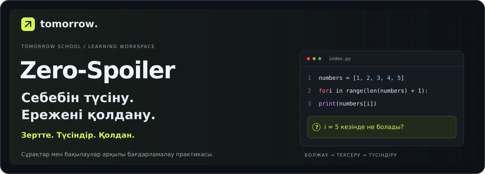
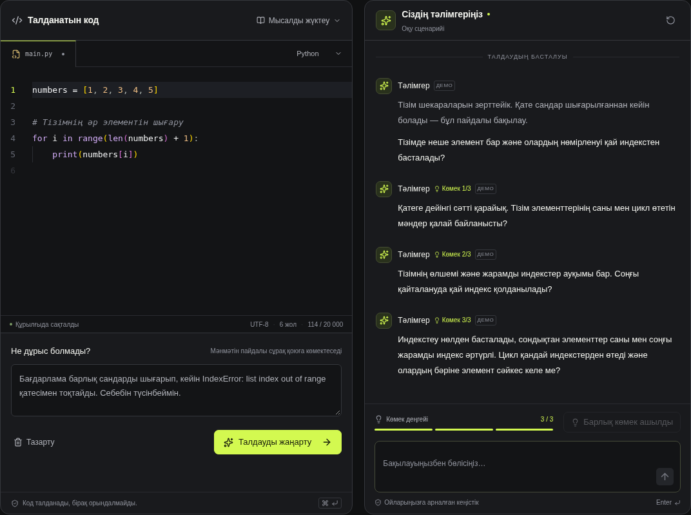

[Русский](README.md) · [Қазақша](README.kk.md) · [English](README.en.md)

<p align="center"></p>

<h1 align="center">Zero-Spoiler Debugger</h1>

<p align="center"><strong>Алғашқы болжамнан студент түсіндіріп, қолдана алатын ережеге дейін.</strong><br>Кодтағы қателерді зерттеуге арналған оқу кеңістігі. Tomorrow School кейсі.</p>

<p align="center"><a href="https://2-case.vercel.app/?lang=kk"><strong>Қолданбаны ашу</strong></a> · <a href="https://2-case.vercel.app/investigation?mode=jury&amp;lang=kk"><strong>Қазыларға арналған демо</strong></a> · <a href="docs/presentation/README.md"><strong>Қорғау материалдары</strong></a></p>

<p align="center"></p>

---

## Код жұмыс істеді. Ал студент түсінді ме?

Қатені түзеткеннен кейін студент оның себебін түсіндіріп, ұқсас жағдайда әрекет ете алатынын тексеру маңызды. Zero-Spoiler осы жолды сақтайды: болжам, нәтижені ашуға дейінгі жауап, бақылау, үйренушіге түсіндіру және жаңа тапсырма.

**Зерттеу → тәлімгер болу → өз ережесін тексеру.**



*Қолданбаның нақты интерфейсі. Суреттерде демонстрациялық өту көрсетілген.*

## Тілдер

**Русский · Қазақша · English.** Жоғарғы тіл ауыстырғыш интерфейсті, оқу сұрақтарын, көмекті және тәлімгер жауаптарын өзгертеді. Таңдау браузерде сақталады. Тілді ауыстырғанда оқу прогресі сақталады, ал өз жазбаларыңыз бен жеке кодыңыз аударылмайды.

## Жобаның ерекшеліктері

| Мүмкіндік | Студент не істейді | Кейін нені талқылауға болады |
| --- | --- | --- |
| **Бақылауға дейін болжау** | Нәтижені болжап, содан кейін бағдарламаның күйін ашады | Алғашқы жауаптар мен кейінгі әрекеттер |
| **Рөлдерді ауыстыру** | Виртуалды үйренушіге қатені түсіндіріп, нақтылаушы сұрақтарға жауап береді | Өз түсіндірмесі және басқа мәндермен тексеру |
| **Жаңа тапсырма** | Ережені басқа жағдайда қолданады | Алғашқы жауап, негіздеме және қайта әрекеттер |
| **Түсіну паспорты** | Қорытындыларын жинап, оқу жолын сақтайды | Оқытушымен талқылауға арналған құжат; PDF және JSON экспорты |

## Зерттеу жолы

```text
Болжам → Болжау және бақылау → Рөлдерді ауыстыру → Жаңа тапсырма → Паспорт
```

Үш дайын сценарий: **тізім индекстері**, **шарт шекаралары** және **циклдегі күйдің өзгеруі**. Оларға API кілті қажет емес. Бақылаулар бекітілген мысалдарға дайындалған; виртуалды үйренуші — әдейі қате жіберетін оқу рөлі.

## Бірнеше минутта байқап көріңіз

1. [Қазақ тіліндегі демоны](https://2-case.vercel.app/investigation?mode=jury&lang=kk) ашып, «Шекарадан бір қадам» сценарийін таңдаңыз.
2. Алғашқы жауап пен болжамды бекітіңіз. Бақылауларды ашпай тұрып болжаңыз.
3. Үйренушіге қатені түсіндіріп, оның нақтылаушы сұрақтарына жауап беріңіз.
4. Жаңа тапсырманы шешіп, түсіну паспортын ашыңыз.

Өзіңізге ыңғайлы қарқынмен өтіңіз. Оқу режиміне OpenAI қажет емес.

## Екі жұмыс режимі

| | Оқу зерттеуі | Еркін талдау |
| --- | --- | --- |
| **Кіріс** | Үш дайын сценарийдің бірі | Өз кодыңыз бен мәселенің сипаттамасы |
| **Практика** | Болжам, бақылаулар, рөлдерді ауыстыру және жаңа тапсырма | Тәлімгермен диалог және үш көмек деңгейі |
| **OpenAI** | Қажет емес | Нақты ЖИ режиміне серверлік API кілті қажет |
| **Нәтиже** | Түсіну паспорты | Сұрақтар, жауаптар мен көмек тарихы |

Еркін талдауда Python, JavaScript, TypeScript, Go және Rust қолжетімді. Модель жауабы көрсетілмес бұрын сүзгіден және бөлек модельдік тексеруден өтеді. Дайын демодиалогтар интерфейсте анық белгіленген.

## Жобаның күйі

**Көрсетуге дайын, жұмыс істейтін MVP.** Monaco редакторы, тәлімгермен диалог, дайын оқу сценарийлері, телефонға бейімделген интерфейс, ашық және қараңғы тақырыптар, жергілікті тарих және паспорт экспорты бар.

Автоматты тесттер API әрекетін, жауаптарды тексеруді, оқу жолын және аудармаларды қамтиды. 5–10 қатысушыға арналған ерікті пилот хаттамасы дайын; нақты студенттердің нәтижелері әлі жиналған жоқ. Қолданбаны тексеру оқыту тиімділігін дәлелдемейді.

## Жергілікті іске қосу

**Node.js 22.13+** және **pnpm 11** қажет. Node.js 24 ұсынылады.

```sh
pnpm install
pnpm dev
```

**http://127.0.0.1:3000/?lang=kk** мекенжайын ашыңыз. Дайын оқу сценарийлері мен демодиалогтарға кілт қажет емес.

OpenAI арқылы талдау үшін `.env.example` файлын `.env.local` ретінде көшіріп, серверде `OPENAI_API_KEY` баптаңыз және серверді қайта іске қосыңыз. Редактор үстіндегі OpenAI режимін таңдаңыз. Интерфейстің таңдалған тілі тәлімгер жауабының тілін де анықтайды. Код пен диалог OpenAI қызметіне жіберіледі; кілтті репозиторийге қоспаңыз.

```sh
pnpm test
pnpm lint
pnpm typecheck
pnpm build
pnpm start
```

## Репозиторий құрылымы

```text
src/app/                 Беттер мен серверлік API
src/components/          Редактор, тәлімгер интерфейсі және тіл ауыстырғыш
src/lib/i18n/            Ағылшын және қазақ тілдерінің сөздіктері
src/lib/                 Сценарийлер, сақтау және тәлімгер логикасы
tests/                   API, оқу жолы және аударма тексерістері
docs/presentation/       Слайдтар мен сөйлеу сценарийлері
docs/images/             README мұқабалары және интерфейс суреттері
cloud-site/              Қолдаудағы Sites адаптері
```

## Қорғау материалдары мен құжаттама

- [Слайдтар мен сөйлеу сценарийлері](docs/presentation/README.md) — қазіргі материалдар орыс тілінде.
- [Телефоннан материалдарды қарау](https://2-case.vercel.app/presentation.html).
- [Пилот әдістемесі қазақ тілінде](https://2-case.vercel.app/pilot?lang=kk).
- [Әзірлеу нұсқаулығы](docs/development.md) және [пилот хаттамасы](docs/pilot-protocol.md) — орыс тіліндегі техникалық құжаттар.
- [Орта айнымалылары](.env.example).

Прогресс пен тарих осы браузерде сақталады, құрылғылар арасында синхрондалмайды. MVP мәтінді талдап, дайын бақылауларды қолданады; еркін кодты орындамайды. Еркін түсіндірмелер автоматты бағаланбайды. Жауаптарды тексеру дайын шешімнің ашылу қаупін азайтады, бірақ толық кепілдік бермейді.

---

<p align="center"><strong>ZERO-SPOILER</strong><br>Зертте. Түсіндір. Қолдан.</p>
