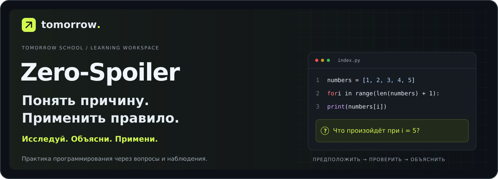
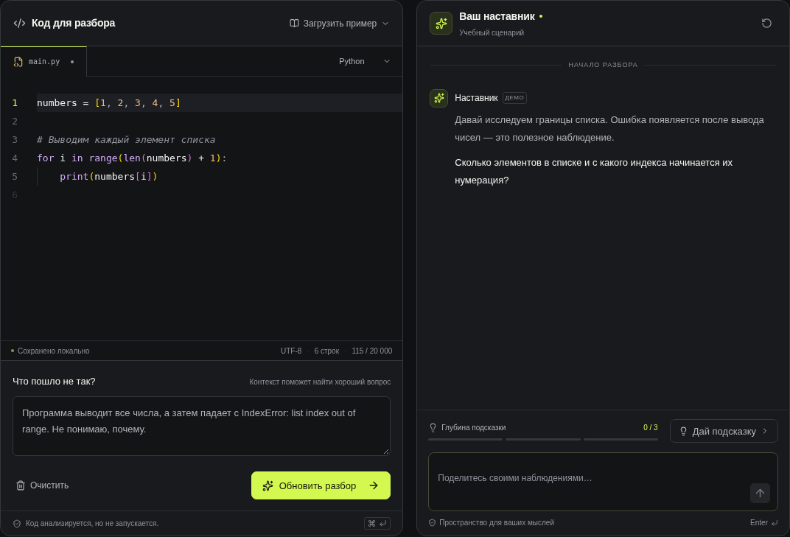
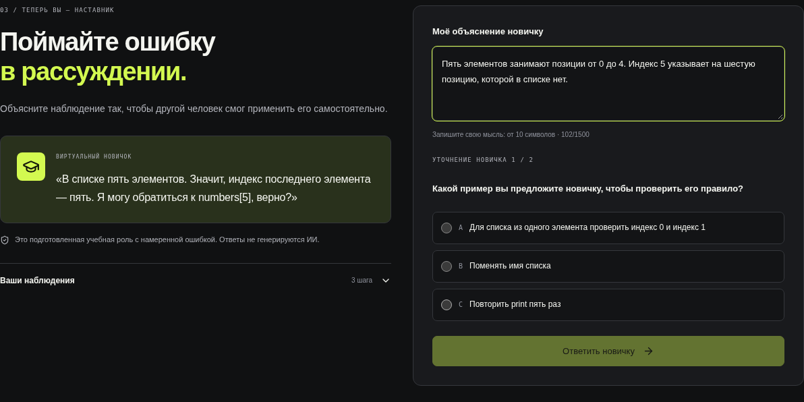
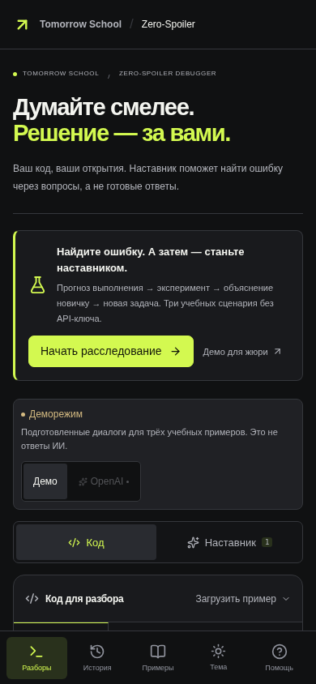

[Русский](README.md) · [Қазақша](README.kk.md) · [English](README.en.md)

<p align="center">
  
</p>

<h1 align="center">Zero-Spoiler Debugger</h1>

<p align="center">
  <strong>От первой догадки — к правилу, которое студент может объяснить и применить.</strong><br>
  Учебное пространство для исследования ошибок в коде. Кейс Tomorrow School.
</p>

<p align="center">
  <a href="https://2-case.vercel.app/"><strong>Открыть сайт</strong></a> ·
  <a href="https://2-case.vercel.app/investigation?mode=jury"><strong>Демо для жюри</strong></a> ·
  <a href="docs/presentation/pitch-solo.md"><strong>Питч на одного</strong></a> ·
  <a href="docs/presentation/pitch.md"><strong>Питч на двоих</strong></a>
</p>

<p align="center">
  
</p>

---

## Код заработал. А студент понял?

После исправления ошибки важно проверить, сможет ли студент объяснить её причину и разобраться с похожей ситуацией. Zero-Spoiler сохраняет этот путь: предположение, прогноз до просмотра результата, наблюдение, объяснение новичку и применение правила на другом коде.

**Студент исследует → становится наставником → проверяет своё правило.**



*Настоящий интерфейс приложения. На скриншотах — демонстрационный проход.*

## Языки

**Русский · Қазақша · English.** Переключатель в шапке меняет интерфейс, задания, подсказки и ответы наставника. Выбор сохраняется в браузере; учебный прогресс и собственные записи не сбрасываются.

[Қазақша ашу](https://2-case.vercel.app/?lang=kk) · [Open in English](https://2-case.vercel.app/?lang=en)

## Что выделяет проект

| Возможность | Что делает студент | Что остаётся для обсуждения |
| --- | --- | --- |
| **Прогноз до наблюдения** | Предсказывает результат, затем открывает состояние программы | Первый ответ и последующие попытки |
| **Смена ролей** | Объясняет ошибку виртуальному новичку и отвечает на уточнение | Собственное объяснение и ответы с другими значениями |
| **Новая задача** | Применяет сформулированное правило в другой ситуации | Первый ответ, обоснование и повторные попытки |
| **Паспорт понимания** | Собирает выводы и сохраняет прохождение | Документ для разговора с преподавателем; экспорт PDF и JSON |

## Как устроено расследование

```text
Гипотеза → Прогноз и наблюдение → Смена ролей → Новая задача → Паспорт
```

Три подготовленных сценария: **индексы списка**, **границы условий** и **изменение состояния в цикле**. Они работают без API-ключа. Наблюдения подготовлены для фиксированных примеров; виртуальный новичок — учебная роль с намеренной ошибкой.



<details>
<summary><strong>Посмотреть мобильную версию</strong></summary>
<br>
<p align="center">
  
</p>
</details>

## Попробовать за несколько минут

1. Откройте [демо для жюри](https://2-case.vercel.app/investigation?mode=jury) и выберите «Один шаг за границу».
2. Зафиксируйте первый ответ и гипотезу. Сделайте прогнозы до открытия наблюдений.
3. Объясните ошибку новичку и ответьте на его уточнения.
4. Решите новую задачу и откройте паспорт понимания.

Прохождение идёт в собственном темпе. В учебном режиме OpenAI не требуется.

## Два режима работы

| | Учебное расследование | Свободный разбор |
| --- | --- | --- |
| **Вход** | Один из трёх подготовленных сценариев | Собственный код и описание затруднения |
| **Практика** | Гипотеза, прогнозы, смена ролей и новая задача | Диалог с наставником и три уровня помощи |
| **OpenAI** | Не требуется | Для live-режима нужен серверный API-ключ |
| **Результат** | Паспорт понимания | История вопросов, ответов и подсказок |

В свободном разборе доступны Python, JavaScript, TypeScript, Go и Rust. Ответ модели проходит фильтр и отдельную проверку на раскрытие решения. Подготовленные демодиалоги явно обозначены в интерфейсе. Подробности — в [описании интеграции и ограничений](docs/development.md#подключение-настоящего-ии).

## Материалы для защиты

| Материал | Открыть |
| --- | --- |
| **Презентация — 8 слайдов** | [PowerPoint](docs/presentation/zero-spoiler.pptx) · [PDF](docs/presentation/zero-spoiler.pdf) |
| **Питч на одного** | [Читать на GitHub](docs/presentation/pitch-solo.md) · [PDF](docs/presentation/pitch-solo.pdf) |
| **Питч на двоих** | [Читать на GitHub](docs/presentation/pitch.md) · [PDF](docs/presentation/pitch.pdf) |
| **Просмотр с телефона** | [Слайды и оба сценария на сайте](https://2-case.vercel.app/presentation.html) |
| **Методика и пилот** | [Страница проекта](https://2-case.vercel.app/pilot) · [Протокол пилота](docs/pilot-protocol.md) |

В сценариях есть тайминг, порядок демонстрации, сокращение до трёх минут и ответы на вопросы жюри.

## Статус проекта

**Работающий MVP, готовый к демонстрации.** Реализованы редактор Monaco, диалог, подготовленные учебные сценарии, мобильный интерфейс, светлая и тёмная темы, локальная история и экспорт паспорта.

В репозитории **автоматические тесты** для серверной логики, проверок ответов и учебного пути. Протокол добровольного пилота с 5–10 участниками подготовлен; результаты реальных студентов ещё не собраны. Проверки приложения не заменяют исследование эффективности обучения.

## Запуск локально

Требуются **Node.js 22.13+** и **pnpm 11**. Рекомендуется Node.js 24.

```sh
pnpm install
pnpm dev
```

Откройте **http://127.0.0.1:3000**. Учебное расследование и подготовленный деморежим доступны без ключа. Для OpenAI создайте `.env.local` по образцу `.env.example` и настройте ключ на сервере.

```sh
pnpm test    # автоматические проверки
pnpm build   # production-сборка
pnpm start   # запуск production-версии
```

## Навигация по репозиторию

```text
src/app/                 Страницы и серверные API
src/components/          Редактор, диалог и учебный интерфейс
src/lib/                 Учебные сценарии, хранение и логика наставника
tests/                   Проверки API и расследования
docs/presentation/       Слайды и сценарии выступления
docs/images/             Обложка и скриншоты README
cloud-site/              Поддерживаемый адаптер Sites
```

[Разработка и архитектура](docs/development.md) · [Переменные окружения](.env.example) · [Пилот и интерпретация результатов](docs/pilot-protocol.md) · [История размещения](docs/sites-deployment.md)

История и учебный прогресс хранятся в браузере. При работе в режиме OpenAI код и диалог отправляются провайдеру. Текущий MVP анализирует текст и использует подготовленные наблюдения; произвольный код не выполняется. Подробнее — в [ограничениях MVP](docs/development.md#облако-и-ограничения-mvp).

---

<p align="center"><strong>ZERO-SPOILER</strong><br>Исследуй. Объясни. Примени.</p>
